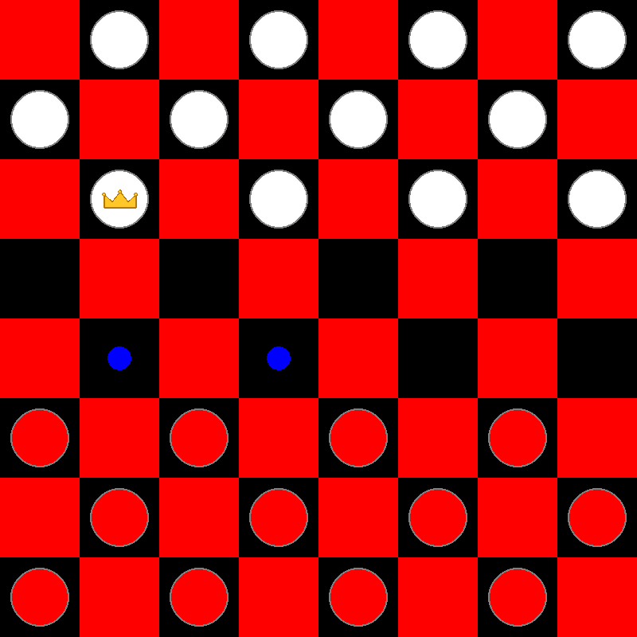

# Checkers

A two-player checkers game written in Python using [pygame](https://www.pygame.org/).



## Features

- Standard 8×8 board with 12 pieces per side
- Click a piece to see its legal moves (shown as blue dots)
- Captures, including multi-jump chains
- Pieces become kings when they reach the far side and can then move backwards
- Turns alternate between red and white, and the game ends when one side has no pieces left

## Running it

```bash
pip install -r requirements.txt
python main.py
```

## Project structure

```
checkers/
├── main.py              – game loop and mouse input
├── assets/              – crown image and screenshot
└── checkers/
    ├── constants.py     – board size and colours
    ├── board.py         – board state, move generation and captures
    ├── piece.py         – a single piece and how it is drawn
    └── game.py          – turns, selection and game state
```
